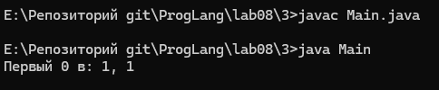
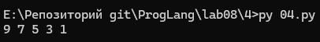
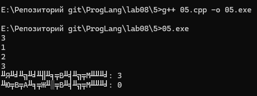
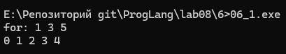
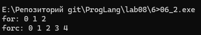
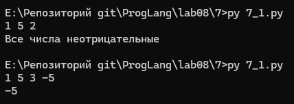
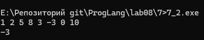
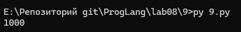

# Отчет по лабораторной работе 8
## Лабораторная работа 8

### Задание 1 **(2)**

#### Текст программы
```python
x = [int(t) for t in input().split()]
i = 0
while i < len(x) and i <= x[i] <= 2 * i:
    i += 1
print(i)
```

#### Объяснение:
* Согласно лекции 8, условие продолжения цикла `while` является отрицанием условия выхода из цикла.
* В исходной программе выход по `break` происходил при условии `x[i] < i or x[i] > 2*i`.
* По закону де Моргана отрицание выражения с оператором `or` меняет его на `and`, а знаки сравнения меняются на противоположные: `x[i] >= i and x[i] <= 2*i`.
* В языке Python это двойное неравенство можно записать компактно: `i <= x[i] <= 2 * i`.
* Также в начало добавлена проверка `i < len(x)`, чтобы индекс не вышел за границы списка.

### Задание 2 **(2)**

#### Текст программы
```python
x = [int(t) for t in input().split()]
i = 0
while i < len(x) and (x[i] < i or 2 * i <= x[i] < 3 * i or x[i] >= 4 * i):
    i += 1
print(i)
```

#### Объяснение:
* В исходной программе цикл прерывался, если число `x[i]` попадало в полуинтервал $[i; 2i)$ или в полуинтервал $[3i; 4i)$.
* Чтобы цикл продолжал работу без оператора `not`, нужно указать все остальные участки числовой прямой.
* Число не входит в эти два промежутка в трех случаях: когда оно строго меньше $i$, когда оно лежит от $2i$ (включительно) до $3i$ (не включая), или когда оно больше либо равно $4i$.
* Проверка `i < len(x)` слева защищает программу от выхода за пределы массива.

### Задание 3 **(2)**

#### Текст программы Main.java
```java
public class Main {
    public static void main(String[] args) {
        int[][] mas = {
            {4, 7, 2},
            {9, 0, 5},
            {1, 3, 0}
        };

        int foundRow = -1;
        int foundCol = -1;

        search: {
            for (int i = 0; i < mas.length; i++) {
                for (int j = 0; j < mas[i].length; j++) {
                    if (mas[i][j] == 0) {
                        foundRow = i;
                        foundCol = j;
                        break search;
                    }
                }
            }
        }

        if (foundRow != -1) {
            System.out.println("Первый 0 в: " + foundRow + ", " + foundCol);
        } else {
            System.out.println("0 не найден");
        }
    }
}
```



#### Объяснение:
* В языках C++ и Python обычная инструкция `break` выходит только из одного (самого внутреннего) цикла.
* Как указано в лекции 8, в языке Java инструкция `break` умеет выполнять выход из любого именованного блока.
* Мы дали внешнему блоку с циклами имя `search`.
* Когда программа находит первый ноль, команда `break search;` мгновенно завершает оба цикла сразу.

### Задание 4 **(2)**

#### Текст программы
```python
a = list(range(10))
b = [a.pop() - x for x in a]
print(*b)
```

#### Результат работы:


#### Объяснение:
* Сначала создается список `a` из десяти чисел: `[0, 1, 2, 3, 4, 5, 6, 7, 8, 9]`.
* Генератор списка относится к функциональной парадигме программирования. Внутри него вызывается метод `a.pop()`, который имеет побочное действие - он удаляет и возвращает последний элемент списка `a`.
* Перебор списка `a` идет слева направо по индексам, а сам список на каждом шаге укорачивается с конца:
  1. Шаг 1 (индекс 0): `x = 0`, метод `a.pop()` забирает `9`. В список `b` идет $9 - 0 = 9$.
  2. Шаг 2 (индекс 1): `x = 1`, метод `a.pop()` забирает `8`. В список `b` идет $8 - 1 = 7$.
  3. Шаг 3 (индекс 2): `x = 2`, метод `a.pop()` забирает `7`. В список `b` идет $7 - 2 = 5$.
  4. Шаг 4 (индекс 3): `x = 3`, метод `a.pop()` забирает `6`. В список `b` идет $6 - 3 = 3$.
  5. Шаг 5 (индекс 4): `x = 4`, метод `a.pop()` забирает `5`. В список `b` идет $5 - 4 = 1$.
* После пятого шага в списке `a` остается всего 5 элементов (`[0, 1, 2, 3, 4]`). Так как 5 элементов уже обработано, цикл завершается.

### Задание 5 **(2)**

#### Текст программы
```cpp
#include <iostream>
#include <vector>

int main() {
    int n;
    std::cin >> n;

    std::vector<int> a(n);

    for (int &x : a) {
        std::cin >> x;
    }

    int last = a.back();
    for (int &x : a) {
        x += last;
    }

    int pos = 0, neg = 0;
    for (int x : a) {
        if (x > 0) {
            pos++;
        } else if (x < 0) {
            neg++;
        }
    }

    std::cout << "Положительно: " << pos << "\n";
    std::cout << "Отрицательно: " << neg << std::endl;

    return 0;
}
```


#### Объяснение:
* В программе используются только циклы по коллекции (`for (type x : collection)`).
* В первых двух циклах переменная объявлена как ссылка `int &x`. Согласно лекции 8, ссылка нужна для того, чтобы изменять сами элементы внутри вектора (при вводе и при сложении).
* Перед вторым циклом последний элемент сохраняется в переменную `last = a.back()`, чтобы прибавить исходное значение ко всем элементам.
* В третьем цикле менять элементы не нужно, поэтому используется обычное копирование значения `int x : a`.

### Задание 6 **(3)**

#### Два основных различия между `forc` и стандартным циклом `for`:

1. **Защита счетчика от изменений в теле цикла:**
   * В конструкции `forc` переменная `i` является константной ссылкой `const int &i = __i` (пример синт. соли из лекции). Программист не может случайно изменить счетчик `i` внутри тела цикла.
   * В обычном цикле `for (int i = from; i < to; i++)` счетчик `i` можно свободно менять внутри цикла, что нарушает дисциплину цикла со счетчиком.
2. **Фиксированное число повторений (однократное вычисление правой границы):**
   * В конструкции `forc` правая граница сохраняется в переменную `__n = to` один раз до начала цикла. Изменение переменных из выражения `to` внутри цикла не повлияет на количество шагов.
   * В обычном цикле `for` условие `i < to` заново вычисляется на каждом шаге. Если переменная `to` изменится внутри тела цикла, изменится и число итераций.

#### Программа 1 - Демонстрация запрета изменения счетчика
```cpp
#include <iostream>

int main() {
    std::cout << "for: ";
    for (int i = 0; i < 5; i++) {
        i += 1;
        std::cout << i << " ";
    }
    std::cout << std::endl;
    {
        int __i = 0, __n = 5;
        for (const int &i = __i; i < __n; __i++) {
            std::cout << i << " ";
        }
    }
    std::cout << std::endl;

    return 0;
}
```


#### Программа 2 - Демонстрация фиксированной границы цикла
```cpp
#include <iostream>

int main() {
    int n1 = 5;
    std::cout << "for: ";
    for (int i = 0; i < n1; i++) {
        std::cout << i << " ";
        n1--;
    }
    std::cout << std::endl;

    int n2 = 5;
    std::cout << "forc: ";
    {
        int __i = 0, __n = n2;
        for (const int &i = __i; i < __n; __i++) {
            std::cout << i << " ";
            n2--;
        }
    }
    std::cout << std::endl;

    return 0;
}
```


### Задание 7 **(2)**

#### Программа на Python
```python
nums = [int(t) for t in input().split()]

for x in nums:
    if x < 0:
        print(x)
        break
else:
    print("Все числа неотрицательные")
```


#### Программа на C++
```cpp
#include <iostream>
#include <vector>

int main() {
    int x;
    bool found_negative = false;

    while (std::cin >> x) {
        if (x < 0) {
            std::cout << x << std::endl;
            found_negative = true;
            break;
        }
    }

    if (!found_negative) {
        std::cout << "Все числа неотрицательные" << std::endl;
    }

    return 0;
}
```


#### Объяснение изменений в алгоритме:
* В языке Python у цикла есть встроенный блок `else`. Он автоматически срабатывает только тогда, когда цикл дошел до конца без вызова `break`.
* В языке C++ конструкции `else` для циклов не существует.
* Из-за этого в алгоритм на C++ пришлось добавить дополнительную логическую переменную-флаг `found_negative` и отдельную проверку `if (!found_negative)` после цикла.
* Это нужно, чтобы программа после завершения цикла смогла определить, по какой причине произошел выход из цикла. 

### Задание 9 **(3)**

#### Текст программы
```python
def t(i):
    return i >= 1000

left = -1
right = 10**18

while right - left > 1:
    mid = (left + right) // 2
    if t(mid):
        right = mid
    else:
        left = mid

print(right)
```


#### Объяснение:
* **Инвариант цикла:** $(t(\text{left}) = \text{False}) \land (t(\text{right}) = \text{True})$.
* Перед входом в цикл инвариант истинен: для `left = -1` функция дает `False`, а для `right = 10**18` дает `True`.
* На каждом шаге мы находим середину отрезка `mid = (left + right) // 2`.
* Если `t(mid)` равно `True`, то граница сдвигается справа (`right = mid`), сохраняя $t(\text{right}) = \text{True}$.
* Если `t(mid)` равно `False`, то граница сдвигается слева (`left = mid`), сохраняя $t(\text{left}) = \text{False}$.
* Цикл продолжается, пока между `left` и `right` есть хотя бы одно целое число, то есть пока `right - left > 1`.
* В момент завершения цикла `left` и `right` стоят на соседних числах (`right - left == 1`), причем $t(\text{left}) = \text{False}$, а $t(\text{right}) = \text{True}$.
* Из этого постусловия следует, что `right` - это первое число $k$, на котором функция становится равной `True`.