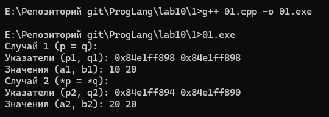
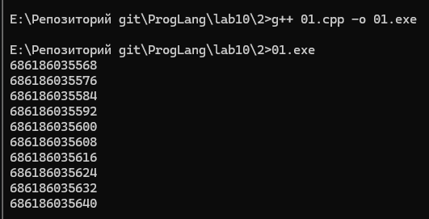
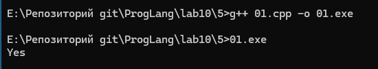
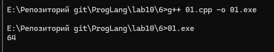
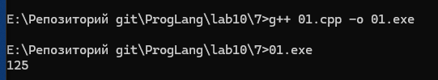
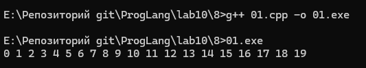
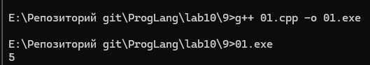
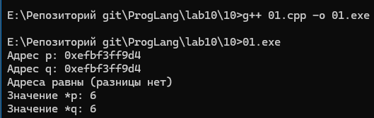
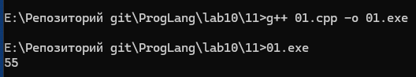

# Отчёт о лабороторной работе 10

---

### Задание 1

#### 1. Значение символов `&` и `*` в программах
* В выражении `&a` и `&b`: унарный оператор взятия адреса объекта в памяти.
* В объявлении `int *p` и `int *q`: описатель типа указателя.
* В выражении `*p` и `*q`: унарный оператор разыменования для получения значения по адресу.

#### 2. Различие присваиваний в третьей строке
* Фрагмент 1 (`p = q;`): меняется сам указатель `p`. Переменная `p` начинает хранить адрес переменной `b`. Значения переменных `a` и `b` не изменяются.
* Фрагмент 2 (`*p = *q;`): разыменовываются оба указателя. Значение переменной `b` (20) копируется в переменную `a`. Указатель `p` продолжает указывать на `a`.

#### 3. Что вывести для демонстрации различий
Чтобы показать различие, можно вывести адреса указателей и значения переменных:

```cpp
#include <iostream>

int main() {
    int a1 = 10, b1 = 20;
    int *p1 = &a1, *q1 = &b1;
    p1 = q1;
    std::cout << "Случай 1 (p = q):" << std::endl;
    std::cout << "Указатели (p1, q1): " << p1 << " " << q1 << std::endl;
    std::cout << "Значения (a1, b1): " << a1 << " " << b1 << std::endl;

    int a2 = 10, b2 = 20;
    int *p2 = &a2, *q2 = &b2;
    *p2 = *q2;
    std::cout << "Случай 2 (*p = *q):" << std::endl;
    std::cout << "Указатели (p2, q2): " << p2 << " " << q2 << std::endl;
    std::cout << "Значения (a2, b2): " << a2 << " " << b2 << std::endl;

    return 0;
}
```

---

### Задание 2

#### Исходная программа и ее вывод
.png)

Исходный код выводит адреса элементов массива `x` в шестнадцатеричной системе счисления.

#### Модифицированная программа (вывод в десятичной системе)
Для перевода адреса в десятичное число используется `reinterpret_cast<size_t>`:

```cpp
#include <iostream>

int main() {
    double x[10];
    for (int i = 0; i < 10; i++)
        std::cout << reinterpret_cast<size_t>(&x[i]) << std::endl;
    return 0;
}
```

#### Объяснение арифметической прогрессии
* Массив располагается в памяти непрерывным блоком.
* Переменная типа `double` занимает 8 байт (`sizeof(double) = 8`).
* Адрес каждого следующего элемента `&x[i]` равен `&x[0] + i * 8`.
* Разность адресов двух соседних элементов постоянна и равна 8, поэтому адреса образуют арифметическую прогрессию с шагом 8.

---

### Задание 3

#### Три случая использования токенов `*` и `&`
Токен `*`:
1. Описатель типа указателя при объявлении: `int *p;`.
2. Бинарный оператор умножения: `c = a * b;`.
3. Унарный оператор разыменования: `*p = 10;`.

Токен `&`:
1. Унарный оператор взятия адреса: `p = &a;`.
2. Описатель ссылочного типа: `int &ref = a;`.
3. Бинарный побитовый оператор И: `c = a & b;`.

#### Пример программы со всеми 6 случаями

```cpp
#include <iostream>

int main() {
    int a = 6;
    int b = 3;

    // 1. '*' как описатель типа указателя
    // 1. '&' как оператор взятия адреса
    int *p = &a; 

    // 2. '&' как описатель ссылочного типа
    int &ref = b; 

    // 2. '*' как бинарный оператор умножения
    int mult = a * b; 

    // 3. '*' как унарный оператор разыменования
    *p = 10; 

    // 3. '&' как бинарный побитовый оператор И
    int biA = a & b; 

    std::cout << "mult: " << mult << ", *p: " << *p 
              << ", ref: " << ref << ", biA: " << biA << std::endl;

    return 0;
}
```

---

### Задание 4

Пошаговый разбор инструкций и значения всех переменных:

1. `unsigned a = 8, b = 3 ,c = 17;`
   * Инициализация переменных: `a = 8`, `b = 3`, `c = 17`.

2. `unsigned *p = &a;`
   * Указатель `p` получает адрес `a`. `p` указывает на `a`.

3. `unsigned *q = &b;`
   * Указатель `q` получает адрес `b`. `q` указывает на `b`.

4. `*p += *q + c;`
   * Вычисляется `*q + c` -> `3 + 17 = 20`.
   * К `*p` (переменная `a`) прибавляется 20. `a = 8 + 20 = 28`.
   * Переменные: `a = 28`, `b = 3`, `c = 17`.

5. `c = *q;`
   * Значение `*q` (переменная `b` = 3) присваивается `c`.
   * Переменные: `a = 28`, `b = 3`, `c = 3`.

6. `p = &c;`
   * Указатель `p` теперь содержит адрес `c`. `p` указывает на `c`.

7. `c += a;`
   * К `c` прибавляется `a` -> `3 + 28 = 31`.
   * Переменные: `a = 28`, `b = 3`, `c = 31`.

8. `*p += 10;`
   * Так как `p` указывает на `c`, к `c` прибавляется 10 -> `c = 31 + 10 = 41`.
   * Переменные: `a = 28`, `b = 3`, `c = 41`.

9. `*q = *p;`
   * Значение `*p` (переменная `c` = 41) присваивается `*q` (переменная `b`).
   * Переменные: `a = 28`, `b = 41`, `c = 41`.

10. `q = p;`
    * Указатель `q` копирует адрес из `p`. Теперь оба указателя `p` и `q` указывают на `c`.

11. `*q += 10;`
    * Так как `q` указывает на `c`, к `c` прибавляется 10 -> `c = 41 + 10 = 51`.
    * Переменные: `a = 28`, `b = 41`, `c = 51`.

Итоговые значения переменных: `a = 28`, `b = 41`, `c = 51`.
Указатели `p` и `q` хранят адрес переменной `c`.

---

### Задание 5

#### Что сравнивается в программе
В условии `if (p < q)` сравниваются адреса памяти, на которые указывают `p` и `q`. 
Значения самих переменных `x` и `y` не сравниваются.



#### Как изменить первую строчку, чтобы результат изменился
Нужно изменить порядок объявления переменных в стеке:
```cpp
int y = 2, x = 1;
```
.png)

Поскольку переменные выделяются в стеке последовательно, смена порядка их объявления изменит их взаимное расположение в памяти. В результате `p < q` сменит значение с `true` на `false` (или наоборот), и вывод изменится.

---

### Задание 6

#### Объяснение работы программы



* Выражение `d + 4` смещает указатель на 4 элемента типа `double` вперед. Адрес увеличивается на `4 * sizeof(double) = 32` байт.
* Выражение `d - 4` смещает указатель на 4 элемента назад. Адрес уменьшается на `4 * sizeof(double) = 32` байт.
* `reinterpret_cast<size_t>` приводит физические адреса в байтах к целочисленному типу.
* Разность вычисляется как `(&x + 32) - (&x - 32) = 64`. Программа выведет `64`.

#### Как изменится результат при смене типа

.png)

Формула для результата в байтах: `8 * sizeof(type)`.
* Для типа `int` (`sizeof(int) = 4`): выведет `8 * 4 = 32`.

---

### Задание 7

#### Объяснение работы программы



* `reinterpret_cast<double*>(3000)` и `reinterpret_cast<double*>(2000)` преобразуют числа 3000 и 2000 в указатели типа `double*`.
* В C++ разность двух указателей одинакового типа `p - q` возвращает количество элементов данного типа между ними.
* Формула разности указателей: `(адрес1 - адрес2) / sizeof(type)`.
* Для типа `double` (`sizeof(double) = 8`): `(3000 - 2000) / 8 = 1000 / 8 = 125`.

#### Как изменится результат при смене типа

.png)

* Для типа `int` (`sizeof(int) = 4`): `1000 / 4 = 250`.

---

### Задание 8

#### Заполнение многоточий в программе
Выглядит программа так:

```cpp
#include <iostream>

int main() {
    int a[20];
    for (int i = 0; i < 20; i++)
        a[i] = i;
    int *b = a + 8;
    for (int i = -8; i < 12; i++)
        std::cout << b[i] << ' ';
    return 0;
}
```

#### Объяснение
* Переменная `b` указывает на `a + 8`, то есть на элемент `a[8]`.
* Операция индексации `b[i]` эквивалентна `*(b + i) = *(a + 8 + i) = a[8 + i]`.
* Чтобы начать вывод с `a[0]`, подставляем `8 + i = 0`, откуда `i = -8`.
* Чтобы закончить элемент `a[19]`, подставляем `8 + i = 19`, откуда `i = 11`. Следовательно, условие продолжения `i < 12`.

---

### Задание 9

#### Что выводит программа


Разность двух указателей одного массива `&a[8] - &a[3]` вычисляет расстояние между ними в элементах.
Формула: `8 - 3 = 5`. Программа выведет `5`.

#### Изменится ли результат при смене типа элементов массива
Нет, результат не изменится. В C++ разность указателей всегда измеряется в количестве элементов соответствующего типа, а не в байтах.

---

### Задание 10

#### Работа программы:
```cpp
#include <iostream>

int main() {
    int x[10] = {1, 2, 3, 4, 5, 6, 7, 8, 9, 10};
    int *p = x + 5;
    int *q = &x[5];

    std::cout << "Адрес p: " << p << std::endl;
    std::cout << "Адрес q: " << q << std::endl;

    if (p == q) {
        std::cout << "Адреса равны (разницы нет)" << std::endl;
    } else {
        std::cout << "Адреса различаются" << std::endl;
    }

    std::cout << "Значение *p: " << *p << std::endl;
    std::cout << "Значение *q: " << *q << std::endl;

    return 0;
}
```



#### Разница между инициализацией `p` и `q`
Разницы нет. Обе записи дают одинаковый адрес элемента `a[5]`.

#### Обоснование
* Имя массива `x` в выражениях приводится к указателю на его первый элемент `&x[0]`.
* Выражение `x + 5` выполняет смещение указателя на 5 элементов типа `int` вправо.
* По определению оператора `[]`, запись `x[5]` тождественна `*(x + 5)`.
* Взятие адреса `&x[5]` превращается в `&*(x + 5)`, что эквивалентно `x + 5`.

---

### Задание 11

#### Программа подсчета суммы элементов массива через указатели

```cpp
#include <iostream>

int main() {
    int x[10] = {1, 2, 3, 4, 5, 6, 7, 8, 9, 10};
    int s = 0;
    for (int *p = x; p < x + 10; p++)
        s += *p;
    std::cout << s << std::endl;
    return 0;
}
```

# Практика по Python 5

### Задание 1. Усреднение последовательности

```python
n, m = map(int, input().split())
a = [float(x) for x in input().split()]

for _ in range(m):
    b = [0.0] * n
    b[0] = (2 * a[0] + a[1]) / 3
    b[n - 1] = (2 * a[n - 1] + a[n - 2]) / 3

    for i in range(1, n - 1):
        b[i] = (a[i - 1] + a[i] + a[i + 1]) / 3

    a = b

print(*a)
```

### Задание 2. Сортировка по абсолютному значению

```python
n = int(input())
a = [int(x) for x in input().split()]

a.sort(key=lambda x: abs(x) * 2 + (1 if x > 0 else 0))

print(*a)
```

### Задание 3. Гербафрика

```python
word = input().strip()
n = int(input())

d = {}
for _ in range(n):
    key = input().strip()
    val = input().strip()
    d[key] = val

for i in range(1, len(word)):
    left = word[:i]
    right = word[i:]
    if left in d and right in d:
        print(d[left] + d[right])
        break
```

### Задание 4. Транспонирование матрицы

```python
n, m = map(int, input().split())

a = []
for _ in range(n):
    row = [int(x) for x in input().split()]
    a.append(row)

for j in range(m):
    new_row = []
    for i in range(n):
        new_row.append(a[i][j])
    print(*new_row)
```